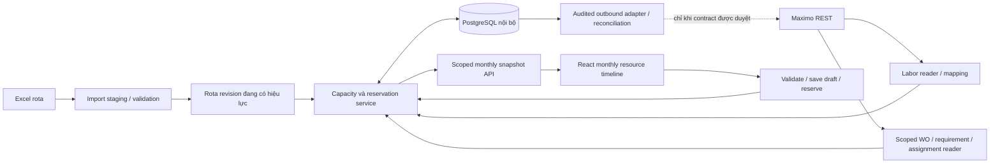

# Kiến trúc đề xuất: Assignment Manager resource timeline

Ngày: 2026-10-11. Trạng thái: đề xuất kiến trúc sau đối chiếu năm file đính kèm,
code hiện có và đánh giá độc lập Astra/high. Đã có
[PoC giao diện giả lập](assignment-timeline-poc.md) và
[phân bổ nội bộ theo WO](workforce-allocations.md);
đã xác minh LABOR GET trên Onshore Test; ASSIGNMENT REST chưa xác minh. Đây là phần mở rộng của
[kiến trúc hiện tại](architecture.md), không thay contract WO đã nghiệm thu.
Đã triển khai [upload và staging thật](rota-live-staging.md), migration0009,
PostgreSQL preview/mapping/restore và LABOR REST. Browser Entra thật upload ODS
87người×365ngày,73mapping/14blocker; reload giữ revision. Planner của poolconnection
và Admin được xử lý5craft theo xác nhận chủ dự án; quyền WO không mở rộng.
Đã triển khai [activation và daily capacity](rota-activation.md), migration0010,
được kiểm tra bằng dữ liệu giả lập trên PostgreSQL. Ledger v1 lưu phân bổ chung
qua API/PostgreSQL0011, kiểm tra budget/ngày và replacement rota dưới cùng khóa
pool. Timeline theo tháng toàn bộ WO, scenario draft và external assignment
adapter trong tài liệu vẫn là thiết kế cho giai đoạn sau.
Policy upload hiện tại chỉ nhận Company BD POC/BDPOC. Preview báo đầy đủ lỗi
LABOR/craft để Maximo admin sửa trên Maximo; uploader không map thủ công hoặc
override craft. Làm mới LABOR tính lại binding tự động sau khi admin sửa.

Policy hiện tại **2026-10-12/v5** loại Material Controller khỏi Labor/capacity;
thay quyết định tính role này ngày11/10. PERSON.title được đọc/hiển thị và dùng
phân biệt exact-name duplicates khi duy nhất title khớp position rota; không
đoán theo craft. Source cũ giữ bất biến, preview áp lọc mới; activation yêu cầu
upload lại v5. Snapshot thật mới85mapped/0LABORblocker, không còn14lỗi trước đó.

## Cập nhật triển khai 2026-10-12

[Resource timeline thật](resource-timeline.md) đã nối roster v5 và ledger API.
Bố cục theo PoC, Planner chỉ thấy/chọn resource craft trùng discipline được
cấp quyền; không có Admin bypass WO. Import/staging/activation tổng thể
Admin-only, thay quyền implicit Planner trước đây. Các đoạn thiết kế/lịch sử
bên dưới được đọc cùng quyết định mới này. CRUD click/dialog đã nghiệm thu
local; kéo chuột native còn cần xác nhận vì IAB automation không phát HTML drag.

## 1. Phạm vi và quyết định chính

- Năm craft chuẩn: `E&I`, `MECH` (hiển thị Mech), `RES`, `P&P`, `DECK`.
- Mỗi người có đúng một planning craft tại một thời điểm; role/chức danh (TECH/SUP/ASST_SUP, Control RM Engineer)
  là thuộc tính riêng. Đổi craft phải có ngày hiệu lực và audit để không đổi lịch sử.
- Rota là một pool nhân sự chung, không chia theo giàn hoặc site. Connection/site
  thuộc WO và mapping Maximo, không phải chiều khóa của capacity.
- Excel là nguồn availability; Maximo REST là nguồn labor identity, WO,
  requirements/assignment hiện có nếu object structure được xác minh.
- Ngày làm việc được xác nhận có 10.5 giờ, lưu chính xác bằng **630 phút**.
  Không tự bỏ thứ Bảy/Chủ nhật; availability do rota quyết định.
- Policy chủ dự án xác nhận 2026-10-11: bỏ qua ô rota trống, không tạo giờ khả
  dụng hoặc allocation cho ô đó. Xác nhận mới thay thế policy loại trừ trước đó:
  Control RM Engineer thuộc P&P, tính capacity theo rota, giữ chức danh riêng,
  không tự đổi thành TECH. Material Controller đã bị loại theo xác nhận12/10;
  không có planning capacity hoặc enrollment. Ô trống không
  làm xóa identity của người hoặc các ngày khác có mã hợp lệ.
- Chỉ đưa LABOR vào pool sau khi đối chiếu đúng người có tên trong rota, với
  binding duy nhất đã xác minh. LABOR ACTIVE nhưng không có tên trong rota không
  được đưa vào timeline/capacity; status ACTIVE không chứng minh còn làm việc.
  Normalize dấu/khoảng trắng để tìm ứng viên, không tự chọn tên gần giống;
  ambiguous/unmatched phải nằm ngoài pool. Người rota chưa map được LABOR giữ
  trong staging để xử lý, không tự tạo external identity. Craft/role theo rota;
  craft Maximo khác rota cần cảnh báo và xử lý trước khi activation.
- Chủ dự án xác nhận2026-10-11: SUP và ASST_SUP của từng craft có tính capacity
  theo rota và được phân công hỗ trợ khi thiếu nhân lực. Hiển thị mục riêng cho
  TECH, SUP và Assistant SUP trong mỗi craft; capacity TECH chính và capacity
  hỗ trợ được báo riêng. Mỗi SUP/ASST_SUP có tối đa630 phút/ngày có mã working,
  cùng ledger người/ngày; không cần xin xác nhận lại cho từng lần planner chọn.
- V1 là phân bổ nội bộ theo người × ngày × WO. Giữ khả năng ghi actual assignment
  ở adapter riêng, khóa cho đến khi có contract/quyền/UAT. Không dùng
  `assignedtechname` để giả lập ASSIGNMENT.
- Tháng là cửa sổ xem, không phải ranh giới sở hữu reservation. Một người/ngày
  chỉ có một budget dùng chung cho các plan đang có hiệu lực.

Operational pool có timezone được cấu hình rõ. Một pool cho nguồn rota nghiệp vụ;
test/synthetic dùng pool cách ly với production để không tiêu hao capacity thật.
Không tạo pool mới chỉ vì đổi site/giàn. Nếu cùng người hiện diện ở nhiều connection,
phải map về một person UUID trong cùng pool; tên giống nhau không chứng minh cùng người.

## 2. Kiến trúc tổng thể



Giữ React/TypeScript + FastAPI + PostgreSQL. Backend là nơi quyết định quyền,
availability, minutes và concurrency; timeline library chỉ hiển thị/tương tác.
V1 chưa cần broker, optimizer hay microservice. Import bị giới hạn kích thước,
số sheet/dòng/ngày và thời gian xử lý; Excel parsing chạy ngoài async event loop.
Nếu quy mô đo được cần job nền, dùng durable job trong DB trước khi thêm broker.

## 3. Bố cục giao diện tháng

```text
Assignment Manager   [connection / environment] [tháng 11/2026] [Hôm nay]
[Import rota] [Refresh labor/WO] [Lưu nháp] [Đưa vào kế hoạch chung] [Preview]

Backlog WO          Resource / craft       01    02    03 ... 30
                    E&I                   42h   31.5h ...   <- capacity TECH
WO / priority       ├─ Người A             6/10.5 10.5/10.5  OFF
labor demand        │                     [WO-A 6h] [WO-B 10.5h]
remaining effort    └─ Người B             ...
                    MECH / RES / P&P / DECK (chỉ nhóm có quyền)

Craft × ngày: capacity | reserved | remaining | completeness
Panel chi tiết: WO, người, ngày, giờ, nguồn rota, warning, before/after
```

- Header có ngày và thứ; mỗi resource cell hiển thị load/capacity như `6/10.5h`.
  Header craft hiển thị tổng giờ và số người; không đặt 10.5h chung cho cả craft.
- Trong mỗi craft, các mục TECH, SUP, Assistant SUP, Control RM Engineer (P&P)
  có thể thu gọn riêng, giữ đúng chức danh nguồn. Material Controller chỉ hiển
  thị trong báo cáo loại trừ, không là resource/capacity của timeline thực.
  Summary ngày ghi capacity/load/remaining chính (TECH), hỗ trợ (SUP/ASST_SUP)
  và tổng khi cần. Planner chọn SUP/Assistant SUP để bù thiếu người; card hiện
  role hỗ trợ, không tự chuyển người sang TECH hoặc tự gán WO khi thấy thiếu.
- Resource rows là người, group theo craft. Rota code vẫn hiện trong tooltip;
  màu availability phân biệt working/off/unknown, không chỉ dựa vào màu.
- Một WO có thể có nhiều allocation ở nhiều người/ngày. Card biểu diễn giờ được
  phân bổ trong ngày, không kéo dài giả tạo 6h thành một interval 6h từ nửa đêm.
- Kéo WO vào người/ngày mở editor nhập giờ hoặc chia giờ theo ngày khả dụng.
  Hiển thị preview cho từng ngày trước xác nhận; không tự chia `estdur / 10.5`.
- Kéo/resize theo ngày đề xuất dịch/chia lại allocation, backend validate toàn bộ
  affected days. Không tự đổi PIC, estdur, target date hoặc status của WO.
- Monthly view dùng date cells. Week/day view với giờ bắt đầu/kết thúc là phase
  sau; chưa có giờ ca thì không tuyên bố đã chống trùng giờ trong ngày.
- Hiển thị nháp riêng, reservation chung và Maximo-confirmed bằng trạng thái riêng.
  Có undo, keyboard/form thay thế kéo thả, focus rõ, lỗi theo người/ngày.
- Filter site chỉ lọc WO/backlog; không tăng remaining capacity của người.
  Pool vẫn tổng hợp reservation ở các site/connection được cấu hình cùng pool.
- Đổi identity/grant/connection phải hủy stale reads và ẩn state cũ theo policy
  hiện có; chuyển trang trong cùng scope giữ nháp ở memory/server.

## 4. Capacity, workload và giới hạn của số liệu

Theo quy tắc trong file đề xuất, các mã `1`, `OT`, `M`, `OM`, `A`, `AM` được 630
phút. `D/DM/DF`, nghỉ và off được 0. `F/AF` cũng được đề xuất 0 nhưng cần xác nhận
nghiệp vụ vì vẫn có thể là người trên biển. OT/OM không tự tạo thêm capacity.
Giữ policy mã/role có version; unknown code/position là **unknown**, không đổi
thành off hoặc EXCLUDED rồi báo thành công.
Ô trống nằm trong coverage hợp lệ được bỏ qua theo xác nhận của chủ dự án,
tương đương 0 phút có thể phân công; không gắn nhãn nghỉ thực tế. Thiếu người,
thiếu date column hoặc ngày ngoài coverage vẫn là missing/unknown, không áp
quy tắc ô trống để che thiếu dữ liệu.

```text
capacity(person, date) = 630 phút nếu working và đủ điều kiện role
                      = 0 nếu known off / excluded
                      = unknown nếu thiếu coverage / mã chưa được xác nhận

reserved(person, date) = các reservation có hiệu lực + external assignment đã đối soát
remaining = capacity - reserved
scenario_remaining = remaining - thay đổi thuần của nháp hiện tại
```

Ví dụ người A có 10.5h, WO-1 đã giữ 6h thì còn 4.5h. WO-2 thêm 5h phải bị từ
chối khi đưa vào kế hoạch chung dù tổng capacity craft còn dư. Hai người cùng
làm 6h cho một WO tạo 12 labor-hours; không có nghĩa estdur của WO là 12h.
Ngày làm 6h không đủ để xác định thời điểm trong ca, permit hay đồng thời thực hiện.

- TECH là capacity chính. SUP/ASST_SUP là capacity hỗ trợ đã được chủ dự án
  cho phép tham gia khi thiếu nhân lực. Budget của mỗi người lấy từ rota, tối đa
 630 phút/ngày working; còn lại trừ các reservation hiện hành của chính người đó.
  Báo riêng TECH và SUP/ASST_SUP; tổng có hỗ trợ=TECH+SUP+ASST_SUP, mỗi người chỉ
  được tính một lần. Đây là role nguồn lực, không cấp thêm quyền ứng dụng/WO.
  Planner phân công hỗ trợ trực tiếp trong phạm vi quyền; chưa có yêu cầu phải
  chứng minh mọi TECH đã hết giờ hoặc một workflow phê duyệt hỗ trợ riêng.
- Craft heatmap dùng tổng budget cá nhân đủ điều kiện. Tách capacity rota đã biết
  với capacity có labor binding hợp lệ để assign trên connection đang xem.
- Một người có nhiều labor rows/default crafts không được tạo nhiều resources.
- Nháp thay thế/simulation không chiếm capacity toàn pool. Chỉ reservation chung
  đã có hiệu lực mới trừ budget. Sửa reservation hiện có tính phần chênh lệch,
  không cộng cả baseline và bản thay thế.
- Không cộng đôi local reservation và Maximo assignment tương ứng: liên kết bằng
  remote assignment identity đã xác nhận. Unknown outbound outcome vẫn giữ chỗ
  cho đến khi đối soát, không trả giờ về pool chỉ vì timeout.
- Trước khi đọc được toàn bộ external assignments, ghi `local-only` hoặc
  `incomplete`; không gọi remaining là toàn bộ giờ rảnh thực tế trong Maximo.
- Nhu cầu craft/skill/hours lấy từ planned labor/requirement REST đã xác minh,
  hoặc nhập tay có nguồn/audit. Không có nhu cầu thì báo chưa biết còn thiếu bao
  nhiêu người/giờ. WO discipline không đồng nghĩa mọi labor requirement cùng craft.

`estdur` hiện được code coi là elapsed duration; `schedfinish` tính theo contract
WO hiện có. V1 không đổi cách tính này. Chuyển sang working-calendar scheduling
cần quyết định nghiệp vụ riêng; allocation envelope không tự trở thành WO finish.

## 5. Mô hình dữ liệu nội bộ đề xuất

Tạo qua Alembic trong hệ thống hiện tại; không chạy trực tiếp `schema.sql` đính kèm.

| Entity | Khóa / trách nhiệm |
| --- | --- |
| resource_pool | UUID, timezone, environment isolation, version |
| resource_person | UUID ổn định trong pool; tên là label; craft/role assignment có hiệu lực |
| labor_binding | person UUID → connection UUID + orgid + laborcode; personid, remote ID/href, active, revision; tuple remote unique |
| rota_import_revision | digest, sheet, parser/policy version, declared coverage, actor Entra, trạng thái staged/validated/active/superseded, report |
| rota_cell | revision + source row + ngày + raw code; provenance bất biến |
| availability_day | projection person/ngày từ active revision, known minutes hoặc unknown, version |
| assignment_plan | plan UUID, owner, window, pool, draft/reserved/archived, version; quyền WO vẫn theo từng item |
| allocation | UUID, person, connection + site + workorderid, requirement/task nếu có, ngày, minutes > 0, source, version |
| capacity_day | pool + person + ngày, budget/reserved minutes, revision/version; row dùng serialize reservation |
| remote_assignment_link | connection + remote assignment ID → allocation/reservation, baseline/revision và reconciliation state |
| assignment_audit / outbound_attempt | actor, changes, scope, durable intent, attempt ID, kết quả từng item và unknown |

Tên bảng là định hướng, chưa phải migration hoàn chỉnh. WONUM dùng để hiển thị;
không làm khóa. Labor identity cần orgid; personid/laborcode không unique toàn hệ
thống. Nếu một người xuất hiện ở cả Onshore/Offshore, cùng person UUID nhưng hai
labor bindings. Mapping across connection phải do người có quyền xác nhận.

Craft/role history dùng effective date để đổi chức danh không viết lại capacity
quá khứ. Theo policy upload đã chốt, LABOR default craft phải khớp craft rota;
Maximo admin xử lý lệch craft tại nguồn, không cấu hình alias trong upload.
Allocation giữ requirement/craft tại thời điểm kế hoạch
và revalidate nếu craft hiện hành thay đổi.

## 6. Import rota: staging → preview → activation

1. Nhận `.xlsx`/`.ods` ở backend; không thực thi macro/formula. Chỉ đọc name,
   position, company, section, date và code; chỉ nhận Company BD POC/BDPOC.
   Không thu thập PP/ID, DOB, nationality hoặc training data.
2. Kiểm tra ngày liên tục, duy nhất, đúng sheet/coverage; không đoán từ “>=28 ô
   date ở 15 dòng đầu” như điều kiện duy nhất. Hỗ trợ file tháng hoặc cả năm,
   sau đó clip tháng chỉ ở read view. Ghi row/cell provenance.
3. Parse giữ mọi row thuộc công ty; tên normalize chỉ sinh candidate matching.
   Trùng tên, trùng người sau mapping, nhiều labor candidates, craft mismatch
   được báo đầy đủ trên preview để Maximo admin xử lý dữ liệu trên Maximo.
   Uploader không map thủ công; refresh chỉ tự map identity duy nhất/craft đúng.
4. Snapshot LABOR REST đủ trang → mapping preview với người có tên trong rota.
   LABOR không có người tương ứng trong rota bị loại khỏi pool kể cả ACTIVE;
   rota chưa match hoặc ambiguous giữ ở staging, không kích hoạt allocation.
   Ghi connection/org và revision của snapshot. Nếu partial/stale thì không tự
   xác nhận binding. So sánh snapshot không tạo thêm người chỉ vì họ có LABOR.
5. Preview diff revision mới/cũ: added/removed people, codes, craft/role, capacity
   reduction và reservation bị ảnh hưởng. File phải khai báo coverage/pool và
   replacement semantics; partial file không được coi là full roster.
6. Activation transaction kiểm tra expected revision, khóa các ngày/người bị
   ảnh hưởng theo cùng cơ chế reservation; đổi active revision/projection atomically.
   Audit actor Entra và policy version. Import cùng bytes/sheet/parser/policy/mapping
   revision phải idempotent; reparse với policy khác tạo revision mới có liên hệ.
7. Trong coverage đã khai báo full replacement, người/cell bị bỏ khỏi revision
   không được tiếp tục dùng availability cũ. Missing được đánh unavailable/unknown
   theo semantics đã xác nhận; không âm thầm coi là ngày làm hoặc off hợp lệ.
8. Rota mới giảm capacity có thể làm reservation hiện có vượt budget: preview
   yêu cầu xác nhận ngoại lệ, activation ghi conflict và khóa thêm giờ/publish ở
   ngày bị ảnh hưởng. Không tự xóa assignment hoặc sửa Excel để che conflict.

Chỉ active revision của từng coverage được dùng; tháng ngoài coverage là unknown.
Activation và reserve phải serialize để không publish theo rota cũ trong lúc đổi
revision. Corrections cho quá khứ giữ nguyên audit và chỉ rõ conflict/history.

## 7. Concurrency, quyền và API

`save draft` chỉ kiểm tra/snapshot đề xuất; `reserve` (UI: Đưa vào kế hoạch chung)
mới chiếm capacity. Trong một DB transaction, khóa person/day rows theo thứ tự
ổn định, kể cả khi ban đầu chưa có row; kiểm tra versions, current scope, active
rota, binding/role và total minutes; ghi allocation + ledger + audit cùng commit.
Bulk move khóa cả ngày nguồn/đích và kiểm tra net delta. V1 một batch reserve là
atomic; Maximo outbound sau này có kết quả riêng từng item.

Hai planner đồng thời gán 6h cho cùng người/ngày: request thắng giữ 6h; request sau
phải đọc lại budget và nhận conflict 409, không để cả hai vượt 10.5h. Plan version
riêng không đủ; ledger chung chống race giữa hai plan. Idempotency key + actor +
payload digest bảo đảm retry sau mất response không tạo allocation lần hai.

API gợi ý, chưa tồn tại:

| API | Nội dung |
| --- | --- |
| GET /api/assignment-timeline?month=YYYY-MM&connection_id=… | scoped resources, availability, allocations, capacity, freshness/completeness, revision bundle |
| POST /api/rota-imports | stage bounded upload, validation report |
| POST /api/rota-imports/{id}/activate | expected active revision + explicit diff acknowledgement |
| POST /api/assignment-plans | tạo scenario draft |
| PATCH /api/assignment-plans/{id} | expected plan version, validate atomic changes |
| POST /api/assignment-plans/{id}/validate | warnings/blockers và net load theo snapshot |
| POST /api/assignment-plans/{id}/reserve | idempotency key, expected versions; current revalidation |
| POST /api/assignment-plans/{id}/release | bỏ local reservation có audit; không tự hủy remote assignment |

Snapshot trả pool timezone, active rota/policy revisions, labor/WO/assignment
snapshot metadata, local ledger revision, read completeness và as-of. Không thể
coi nhiều REST reads là snapshot Maximo atomic; freshness và revalidation phải
hiện rõ. Không lấy WO chỉ bằng target finish như reader hiện tại: thêm scoped
schedule-overlap query và backlog unscheduled/partly assigned. WO/allocations
vắt tháng được clip hiển thị nhưng giữ nguyên identity và hours ngoài tháng.

Phân quyền cần mở rộng rõ ràng:

- WO details giữ grant connection/discipline và PERSON/Planner policy hiện có.
- Quyền xem resource/capacity theo pool/craft, import/mapping/policy activation
  là quyền riêng được audit; Admin cấu hình không mặc nhiên có quyền xem dữ liệu.
- Không tự map craft thành grant discipline. WO khác discipline có thể cần cùng
  craft; điều này không cấp quyền xem WO đó.
  Repo đang có discipline `PROD`; không mặc định `P&P == PROD` ở mọi connection.
  Mapping craft/discipline phải được xác minh, không lấy craft Excel làm proof of access.
- Backend ledger phải thấy tất cả reservation để chống đếm thiếu. Nếu planner
  không được xem WO ngoài scope, API chỉ trả capacity tổng khi đã có quyền resource
  summary, hoặc trả conflict chung không định danh WO/tên/connection ẩn. Không cấp
  summary grant thì không trả giờ bận ngoài scope. Không có quyền đủ để xem năm
  craft thì UI chỉ hiện các craft được cấp; cross-craft manager cần grant explicit.
- Revoke/moved WO làm dữ liệu chi tiết fail closed; reservation vẫn tồn tại và
  người có quyền xử lý, không giải phóng giờ chỉ vì một viewer bị mất quyền.

## 8. REST Maximo và ranh giới ghi

File `maximo_labor.sql` chỉ là tham khảo quan hệ LABOR/PERSON/LABORCRAFTRATE;
không đưa SQL hay Maximo DB credentials vào ứng dụng. OSLC example trong file chưa
có org filter/org fields và không tương đương đầy đủ SQL.

Read-only probe cần xác minh trên từng configured TEST connection:

- Object structure được phép đọc LABOR, person displayname/personid, orgid,
  status/active và laborcraftrate craft/defaultcraft/skill nếu cần.
- Org filter và active/synonym semantics, paging toàn bộ, remote stable ID/href,
  multiple defaultcraft rows, nulls; encode query và chỉ theo trusted links.
- Requirements/planned labor và existing assignments: identity, WO/task relation,
  assigned labor, ngày/giờ, units/status/revision; không suy từ PIC person group.
- Calendar/shift requirement nếu muốn ghi actual assignment, cùng timezone và
  mapping rota vào Maximo calendar availability; Excel capacity không tự sửa
  calendar của Maximo.

Probe được chủ dự án yêu cầu ngày 2026-10-11 xác nhận
`/maximo/oslc/os/mxlabor` trên configured Onshore Test trả HTTP 200. Select từ
comment SQL đọc được `laborcode`, `personid`, PERSON displayname và
LABORCRAFTRATE craft/defaultcraft. Select bổ sung `orgid,status` cùng filter
`status="ACTIVE" and orgid="BDPOC"` trả đủ147records với pageSize200,
totalCount147/totalPages1 và không có nextPage. Không thiếu mã labor/person/name,
không trùng `(orgid,laborcode)`. PERSON và LABORCRAFTRATE là arrays,
`defaultcraft` là boolean. Năm craft có139labor: E&I54, MECH27, RES7, P&P39,
DECK12; ngoài scope có CRANE4/HSE3 và1labor không có default craft.
Một labor có2default rows cùng RES: deduplicate theo craft trước khi kiểm tra
quy tắc một người/một craft, không đếm capacity đôi hoặc xem đây là hai craft.
Đây là roster Maximo, chưa phải87người rota đã map hay headcount working/ngày.

Mẫu pageSize5 có nextPage khác origin configured TEST; probe không theo link.
Reader production-ready vẫn cần xử lý paging an toàn, fail closed khi origin
không hợp lệ, cùng policy missing/default craft và person mapping. Chưa xác minh
Offshore, requirements/assignments hoặc assignment write; chưa triển khai reader.
[Evidence aggregate, không chứa credential/PII](evidence/onshore-labor-read-2026-10-11.json).

IBM xác nhận REST object structures có thể tùy biến theo
installation: [IBM API catalog](https://developer.ibm.com/apis/catalog/maximo--maximo-manage-rest-api/).
Nested selects có hướng dẫn chính thức trong
[IBM REST selecting](https://ibm-maximo-dev.github.io/maximo-restapi-documentation/query/selecting/).

Actual assignment write là domain khác với WO schedule/PIC update. Hiện allowlist
chỉ gồm sáu fields WO; không mở generic PATCH. Cần contract riêng cho create/change/
cancel, revision/conditional write, relationship semantics, local reservation →
remote identity, durable intent, partial success và unknown recovery/read-back.
Không gọi plan “COMMITTED/SYNCED” chỉ vì request 2xx; confirm từng assignment.
PIC là người chịu trách nhiệm, còn allocation có thể nhiều labor. Nếu muốn đổi PIC,
dùng action riêng theo permitted PIC list và preview/upload hiện có.

IBM phân biệt work requirements/craft/skill với labor availability và assignments;
calendar/shift là thành phần của scheduling labor trong Assignment Manager:
[IBM Assignment Manager](https://www.ibm.com/docs/en/masv-and-l/maximo-manage/cd?topic=module-assignment-manager).
Tài liệu Manage hiện hành này hỗ trợ mô hình khái niệm, không thay bằng chứng
contract của installation Maximo 7.6.1.3 đang dùng.

## 9. Những phần cần sửa trong attachment

| Tham chiếu | Vấn đề | Thay đổi trước triển khai |
| --- | --- | --- |
| rota_parser.py: parse_rota / schema crew_member | name_key làm khóa; duplicate name bị skip | source row + person UUID, ambiguity cần resolve, không bỏ người âm thầm |
| parse_rota | unknown code đổi thành blank; unknown position EXCLUDED | giữ raw unknown, block hoặc quarantine rõ; capacity unknown |
| POSITION_ROLE / position_role_seed.sql | hai nguồn policy, một số mapping position còn [?] | một policy version; Control RM Engineer→P&P, Material Controller bị loại theo v5 và SUP/ASST_SUP hỗ trợ, xác minh mapping position còn lại |
| load_db | chỉ delete lịch các crews có trong import; người bị bỏ còn lịch cũ | immutable revision và full-coverage activation/diff |
| load_db | MANUAL giữ laborcode nhưng craft/role có thể bị ghi đè | identity binding độc lập, effective craft/role và mismatch validation |
| schema laborcode unique | không có connection/org namespace | separate labor_binding, scoped remote uniqueness |
| plan_assignment | thiếu connection/workorderid, version/actor/ledger | composite WO identity, plan/version, audited capacity reservation |
| v_plan_load | chỉ sum theo plan, không kiểm tra người/ngày/toàn pool | authoritative shared ledger; alternate drafts không đếm đôi |
| plan COMMITTED / sync_status | không có sending/conflict/unknown recovery | state machine và per-item durable attempts; không retry mù |
| maximo_labor.sql | CSV/SQL path và REST thiếu org/defaultcraft filtering parity | REST-only bounded reader với verified fields/filter/completeness |
| status_code / craft seed | mã F/AF, defaultcraft và alias chỉ là giả định | policy được xác nhận theo nguồn/connection, không tự mở quyền |

## 10. Triển khai và nghiệm thu

1. **V1A:** synthetic monthly UI đã có [PoC](assignment-timeline-poc.md);
   rota staging preview + schema/API
   contract cho daily minutes, TECH/reserve, unknown coverage, UUID identity và
   scenario draft. Chưa cần actual assignment write. PoC đo row count thực tế và
   khoảng 200 WOs đang có, keyboard, scroll/resize, month boundary và draft retention.
2. **V1B, phụ thuộc metadata:** LABOR/requirements/assignment GET probes trên TEST;
   persistent import/mapping/activation + shared reservation ledger + scoped API.
   Nghiệm thu two-planner race, duplicate requests, import capacity reduction,
   removed people, multi-site/multi-connection cùng người và permission revocation.
3. **V2, phụ thuộc nghiệp vụ/Maximo admin:** actual ASSIGNMENT writes, calendar/shift,
   conditional conflict và unknown reconciliation; mở allowlist bằng thay đổi được
   review, UAT từng connection. Chỉ thêm interval/day-hour scheduler nếu có ca rõ.

Frontend PoC ưu tiên đánh giá FullCalendar Premium qua adapter vì có resource
timeline/month view; resource timeline thuộc Premium:
[FullCalendar timeline](https://fullcalendar.io/docs/timeline-view).
Daily cell hours/heatmap và allocation semantics vẫn do ứng dụng quản lý; cần
kiểm chứng background availability theo resource, multi-row WO và keyboard.
Chưa mua/chọn/pin thư viện. Bryntum Scheduler Pro là lựa chọn khi đã cần engine
calendar/dependency/constraints:
[Bryntum Scheduler Pro](https://bryntum.com/products/schedulerpro/).
Không dùng engine client để thay backend validation; lựa chọn/pins/license cần
benchmark và change note dependency trước khi cài.

Checklist nghiệm thu tối thiểu: leap February/30/31 ngày; daily minutes chính xác;
unknown ≠ off; SUP reserve không đếm đôi; trùng tên/craft mismatch; missing roster
không giữ availability cũ; replace revision atomic; 6h+5h trên 10.5h bị chặn;
6h+4.5h hợp lệ; plan alternatives không chiếm đôi; duplicate submission; cross-site
shared capacity; test pool isolation; read partial báo incomplete; hidden WO không
lộ identity; month clipping không mất reservation; timeout giữ unknown/reconcile.

PoC client có tests riêng theo [bằng chứng kiểm tra](assignment-timeline-poc.md#kiểm-chứng--2026-10-11);
chưa có backend reservation/import tests; LABOR Onshore Test có GET evidence,
requirements/ASSIGNMENT live REST chưa được xác minh.
Các bằng chứng upload WO hiện có không chứng minh labor assignment hay capacity.

## 11. Đối chiếu workbook rota mẫu — 2026-10-11

Nguồn: attachment `POB Plan Q4 2026.ods`. Đọc trực tiếp cấu trúc OpenDocument
ZIP/XML bằng Python stdlib ở bundled runtime; không sửa file, chạy macro hoặc
recalculate công thức. Chỉ tổng hợp nhân sự/craft/position/date/code, không lưu
PP/ID, DOB, nationality/Bosiet hay dữ liệu phép năm vào tài liệu.

### Cấu trúc đã xác minh

- Hai sheet: `Master_Activities_2026` và `ROTA_2026`. Dùng sheet ROTA làm nguồn
  availability; master activities/POB summary không phải labor requirement.
- ROTA có header Name/Position/Company ở A3:C3. Dòng ngày là H4:NH4, đủ 365 ngày
  duy nhất, liên tục từ 2026-01-01 tới 2026-12-31. Tên Q4 không giới hạn coverage.
- Dòng thứ H5:NH5 cũng là 365 ô typed date nhưng chỉ có 7 giá trị năm 1900.
  Vì vậy chọn header theo số ô datetime là heuristic dễ chọn sai khi bố cục đổi;
  phải kiểm tra năm, uniqueness, continuity và coverage mong đợi.
- Section rows P&P17, E&I50, RES73, MECHANIC78, DECK CREW98. Dữ liệu nhân sự
  tương ứng A18:C49, A51:C72, A74:C77, A79:C97, A99:C112; có spacer rows.
- Trong năm craft, số row nhân sự 31/21/4/18/13 khớp section labels: tổng87.
  Không có TBA, trùng normalized name, unknown position hoặc unknown code theo
  danh mục attachment. Đây chưa phải xác minh unique identity với Maximo.
- Q4 gồm92 ngày,8004 person-day cells. Các mã có mặt: blank,1,A,AB,AL,AM,D,DM,
  M,O,OM,OT. Cả năm còn có O5,O6,PL,SL. Không thấy F/AF trong năm craft này;
  absence không xác nhận policy của hai mã đó cho file khác.
- Ô `1`/mã ngày có numeric và string types; phải normalize giá trị typed, không
  dựa riêng vào display text. Không có formula trong31755 rota cells của87 người.
- Ba rows38,65,71 trống toàn Q4. Theo xác nhận chủ dự án2026-10-11, bỏ qua các
  ô này và không tạo capacity/assignment Q4 từ chúng; không suy inactive/off
  hoặc xóa person identity chỉ vì một khoảng lịch trống.
- Không thấy literal10.5/10,5 trong sheet ROTA. 10.5 giờ là policy do user cung
  cấp, không phải giá trị giờ đọc từ workbook. Không suy giờ ca từ crew-change day.

### Headcount theo policy position_role đề xuất

| Craft | Tổng | TECH | SUP + ASST_SUP | Control RM Engineer / Material Controller |
| --- | ---: | ---: | ---: | ---: |
| E&I | 21 | 17 | 4 | 0 |
| MECH | 18 | 12 | 4 | 2 |
| RES | 4 | 4 | 0 | 0 |
| P&P | 31 | 17 | 6 | 8 |
| DECK | 13 | 11 | 2 | 0 |
| Tổng | 87 | 61 | 16 | 10 |

Xác nhận mới của chủ dự án ngày2026-10-11 thay thế quyết định loại trừ trước:
8Control RM Engineer thuộc P&P và2Material Controller thuộc MECH đều tính vào
capacity theo rota. Pool rota có87người:61TECH,16SUP/ASST_SUP và10người thuộc
hai chức danh trên; hiển thị chức danh riêng, không đổi thành TECH. Đây là
headcount nguồn, chưa phải số người đã bind LABOR hoặc working mỗi ngày.
Đây là quyết định lịch sử11/10. Xác nhận12/10 loại2Material Controller: pool
hiện tại85người (MECH16), gồm61TECH/16SUP-ASST_SUP/8Control RM Engineer;
bảng87người trên vẫn mô tả file nguồn, không là headcount planning hiện tại.
LABOR không có tên trong rota không vào pool dù ACTIVE; không auto-enroll toàn
bộ139labor của năm craft. SUP/ASST_SUP vẫn được hỗ trợ khi thiếu người.
Các mapping position khác còn dấu[?] cần xác nhận. Seed/parser đính kèm vẫn
chứa policy loại trừ cũ; importer thực tế phải dùng policy mới, không copy nguyên.

### Capacity TECH Q4 tính từ codes, chưa trừ assignment

Dùng WORK_CODES={1,OT,M,OM,A,AM},10.5 giờ/code, blank và các mã còn lại=0 theo
attachment để đối chiếu. Đây là gross rota capacity theo giả định, chưa có labor
binding, planned labor, external assignment hoặc skill/permit. Bảng này chỉ TECH;
capacity SUP/ASST_SUP và Control RM Engineer phải tính/hiển thị riêng;
Material Controller không tính theo v5. Bảng TECH dưới đây không phải tổng craft.

| Craft | Tháng10 (giờ) | Tháng11 (giờ) | Tháng12 (giờ) | TECH làm/ngày tháng11 |
| --- | ---: | ---: | ---: | ---: |
| E&I | 2394 | 2173.5 | 2530.5 | 5–8 |
| MECH | 2184 | 1764 | 1984.5 | 5–7 |
| RES | 577.5 | 556.5 | 651 | 1–2 |
| P&P | 2793 | 2520 | 2677.5 | 8 |
| DECK | 1627.5 | 1795.5 | 1774.5 | 5–6 |

Nguồn ngày/codes: ROTA tháng10 JU4:KY112, tháng11 KZ4:MC112, tháng12 MD4:NH112;
chỉ cộng các row nhân sự TECH trong năm section, không cộng footer hoặc section
labels. Cross-check count:87×365=31755;87×92=8004; danh sách ngày kiểm tra bằng
calendar liên tục. Supervisor hours được tính riêng, không nằm trong bảng TECH.

### Tác động đến thiết kế/import

Giữ import coverage theo ngày thực của sheet (ở mẫu này là cả năm), tháng chỉ
là read window. File import phải xác nhận full replacement hay patch; mẫu có đủ
date columns chưa chứng minh snapshot có đầy đủ roster đang hoạt động.
Timeline v1 quy mô87 rows và tối đa2697 resource/day cells ở tháng31 ngày,
group theo5 craft. Có thể ưu tiên UI tháng đơn giản và benchmark thực tế trước
khi quyết định cần virtualization/engine nâng cao.

Đã xác minh workbook bằng XML độc lập, chưa chạy native `parse_rota()` qua
pandas/ODF engine: bundled runtime có pandas nhưng thiếu odfpy. Không cài dependency
cho task chỉ đọc. Các lỗi duplicate/unknown/removed-person đã nêu là rủi ro ở các
revision khác, không phải lỗi được quan sát trong mẫu này. REST mapping và database
activation/concurrency vẫn chưa được kiểm chứng bởi việc đọc workbook.
